<p align="center">
  
</p>

<h1 align="center">Ascension — Rise of Man</h1>

<p align="center">
  A real-time strategy game from the first villages to an age of galactic empires.<br>
  Round planets, fifteen ages, star clusters, charged jumps, and an ending you choose.
</p>

<p align="center">
  <a href="https://github.com/alfu32/ascension/releases/latest"><b>Download the latest release</b></a>
  · Linux · Windows · macOS
</p>

<p align="center">
  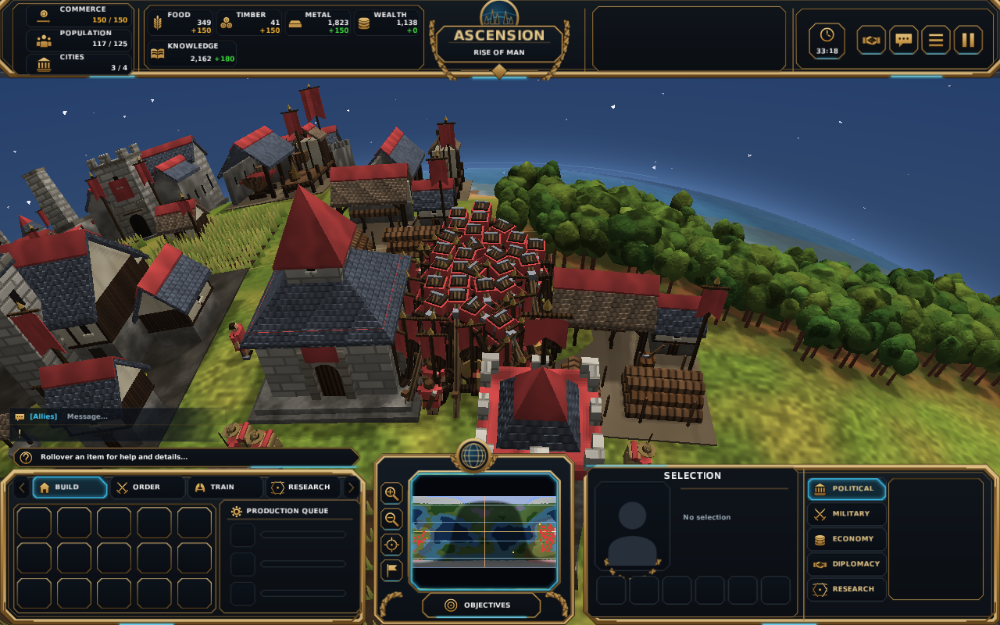
</p>

## What it is

Ascension is a real-time strategy game in which a people grows from an ancient
settlement into a spacefaring civilisation. You found cities on a round planet, gather
food, timber and metal, research at the library, trade at the market and raise armies.
Fifteen ages later your nation has become part of a continental bloc, the blocs have
united as humanity, and your fleets cross between the star clusters of the galaxy.

The world is one continuous place: the camera moves from a street between your houses to
the whole globe, and, once you reach space, out to your star system, its star cluster, a
quadrant of the galaxy and the whole galactic disk.
Nothing is loaded between those views.

Status: in active development, released often. Everything shown here runs in the current
build.

## How it plays

### A round world

Every planet is a sphere of tiles (about 150 buildings around, half of it land), with
oceans, forests, mountains, deserts, ice and snow. Day and night follow the sun's light
across the globe; night stays playable. Each race starts on its own home planet, in its own
star system.

<table>
<tr>
<td>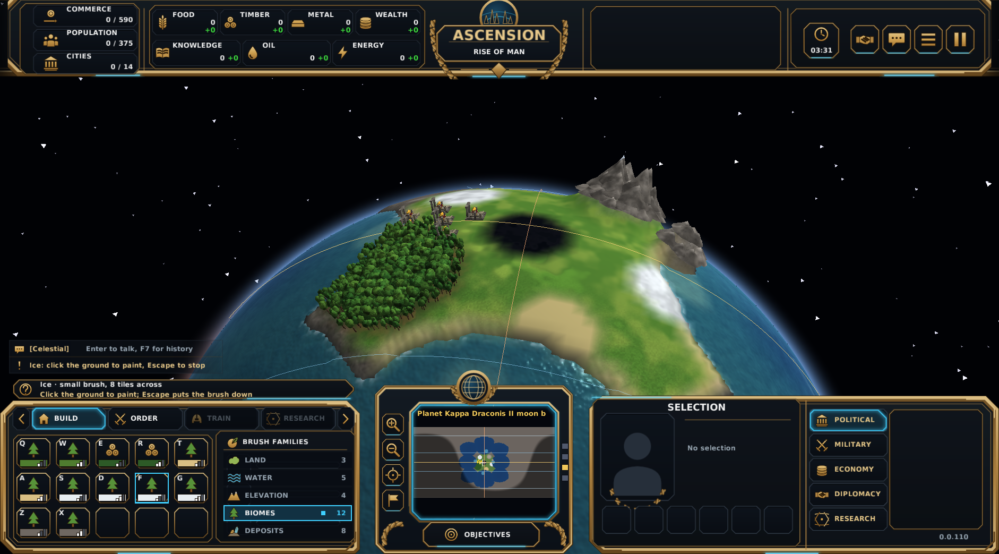</td>
<td>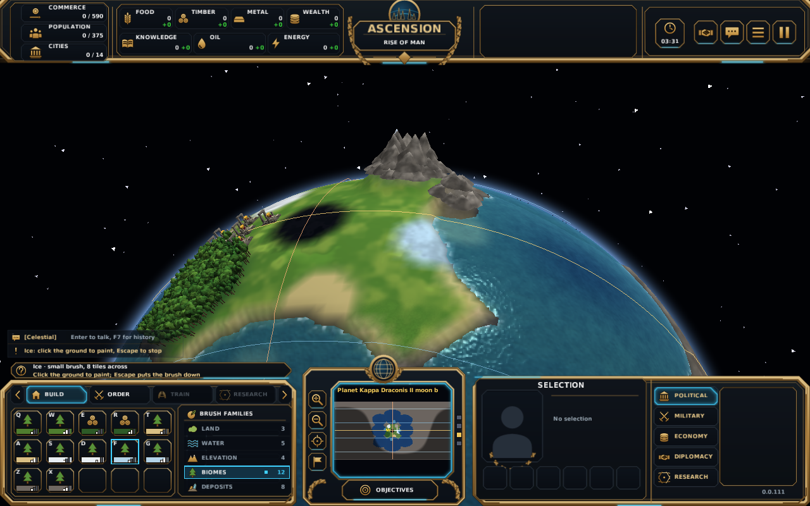</td>
</tr>
<tr>
<td align="center">The home planet from orbit</td>
<td align="center">Ice and snow at the pole</td>
</tr>
</table>

### Cities, resources and the market

Citizens gather **food**, **timber** and **metal**; temples and markets bring **wealth**;
libraries and universities turn **knowledge** into technology (more than two hundred of them). Later ages add
**oil** and **energy**. Cities claim the land around them, houses raise the population cap,
and the market buys and sells resources in lots, at prices that move with your own trading. Caravans and
merchant fleets earn wealth on trade routes, at home and, later, between star systems.

<table>
<tr>
<td>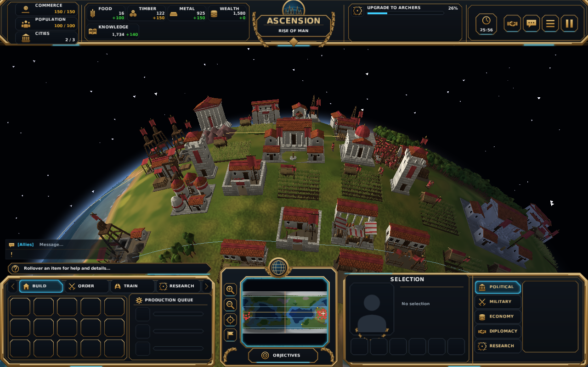</td>
<td>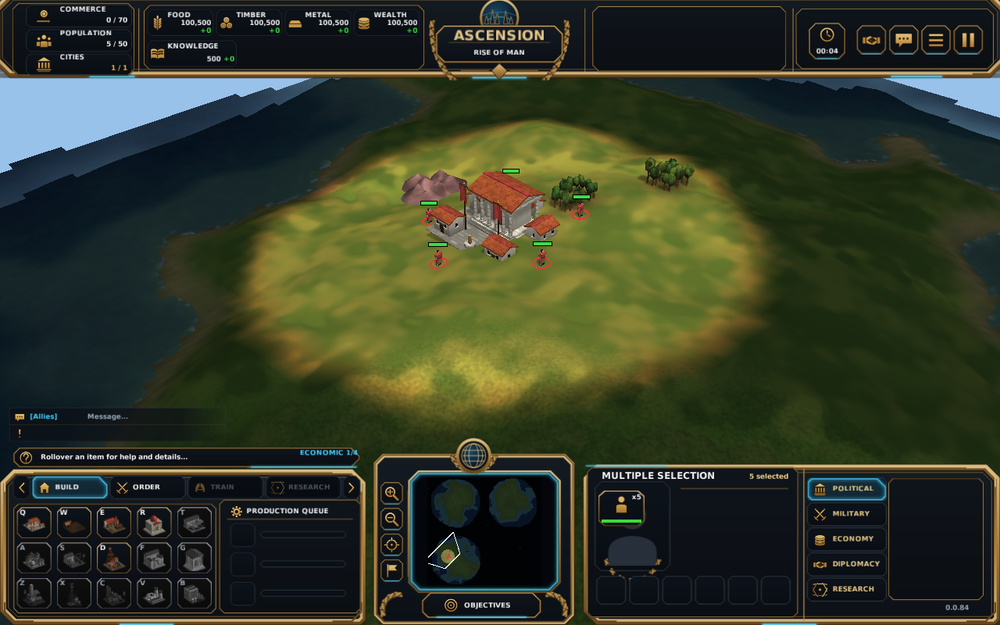</td>
</tr>
<tr>
<td align="center">A town after half an hour</td>
<td align="center">Building in the Classical Age</td>
</tr>
</table>

<p align="center">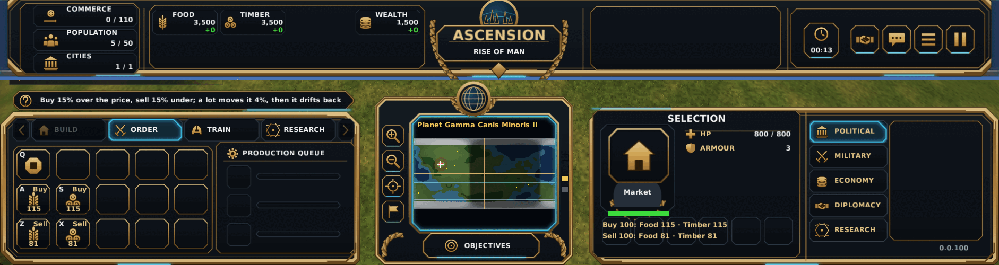</p>

**Set the pace.** Two match options slow the economy down without slowing anything else: the
**gathering rate** (100 % down to 2 % of every income) and the **research speed** (1000 % down
to 5 %). A game can last two hours or several days.

### Fifteen ages

| # | Age | What it brings |
| --- | --- | --- |
| 0 | Ancient | cities, farms, palisades, the first soldiers |
| 1 | Classical | metalwork, temples and priests, stables, siege engines, stone walls |
| 2 | Medieval | castles, heavy cavalry, the cog: troop transports at sea |
| 3 | Discovery | firearms, cannon, ocean-going ships: the first age of discovery |
| 4 | Enlightenment | line infantry, universities |
| 5 | Industrial | oil, factories, medics, the first aircraft, trenches and minefields; citizens learn to swim |
| 6 | Modern | tanks, carriers, missiles, landing ships |
| 7 | Freedom | drones in the air, at sea and on the ground |
| 8 | Automation | robot workers and soldiers; nuclear power; nations merge into continental blocs |
| 9 | Fusion | fusion power; craft that fly, dive and reach near orbit; the first ships and colonies on the other worlds of the home star; soldiers swim and fight from the water |
| 10 | Spacefaring | the whole fleet, and the home star system its own; jetpacks, shield walls, buildings that lift off; the blocs unite as humanity |
| 11 | Starfaring | the jump to the other stars of your cluster; orbital drops; buildings that cross the system |
| 12 | Abundance | everything costs nothing, building still takes time; jumps to the other clusters |
| 13 | Galactic War | rival human empires at war across the stars; buildings that jump to other stars |
| 14 | Galactic Federation | the last age: humanity's federation, and the way to the Ascension |

### Nations, blocs, humanity

You pick a race before the match and keep it: **humans**, **avians** or **reptilians**,
twenty nations in all, from Romans, Egyptians, Chinese and Inca to the broods and flights of
the other races. In the Automation Age the nations of one continent merge into a **bloc**
(Africa, the Americas, Asia, Europe, Oceania); in the Spacefaring Age the blocs become
**united humanity**.

### Armies, sieges and fire from orbit

More than a hundred unit types, from slingers and archers to musket lines, tanks, drones,
orbital batteries and battleships. Units fight in formation, see only as far as their
optics allow, leave the marks of battle on the ground, and every unit that outranges its
target has a counter within reach.

<table>
<tr>
<td>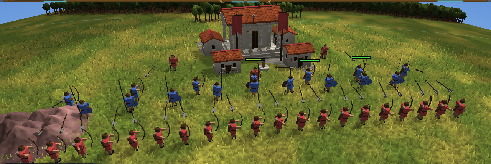</td>
<td>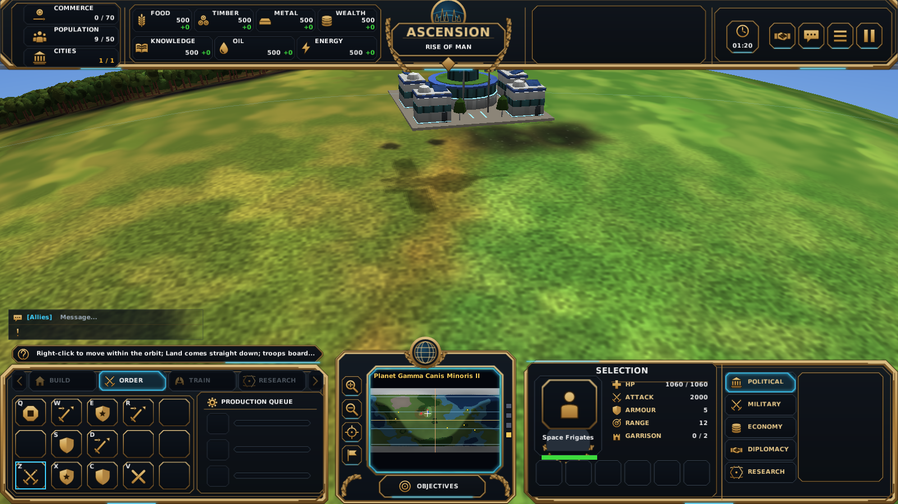</td>
</tr>
<tr>
<td align="center">Archers against a town</td>
<td align="center">Soldiers and tanks</td>
</tr>
<tr>
<td>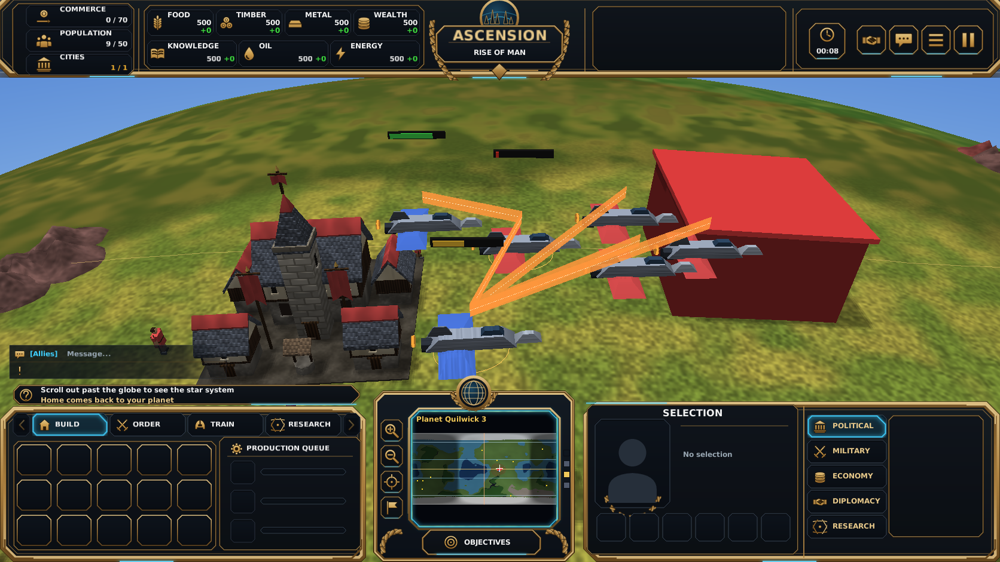</td>
<td>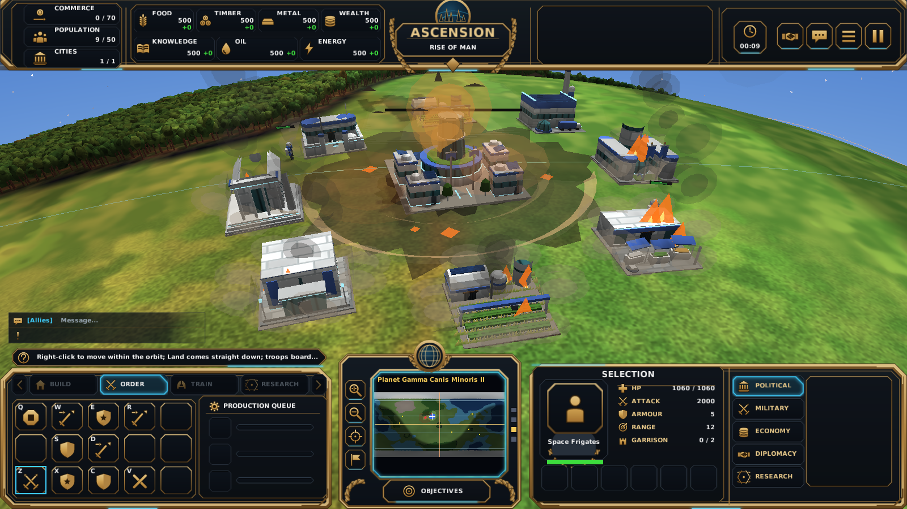</td>
</tr>
<tr>
<td align="center">A dogfight over the city</td>
<td align="center">Bombardment from orbit</td>
</tr>
</table>

### Walls, gates and shields

Drag a line on the ground to build a wall: a palisade, then stone walls, defensive lines with
trenches and tank traps, and from the Spacefaring Age shield emitters, whose energy wall stops
enemies while it has power. Press G while dragging to put a gate in the line; gates let your
own side through. Minefields hide from the enemy. Any building can be turned before you place
it (R), and a gate snaps into a finished wall.

<table>
<tr>
<td>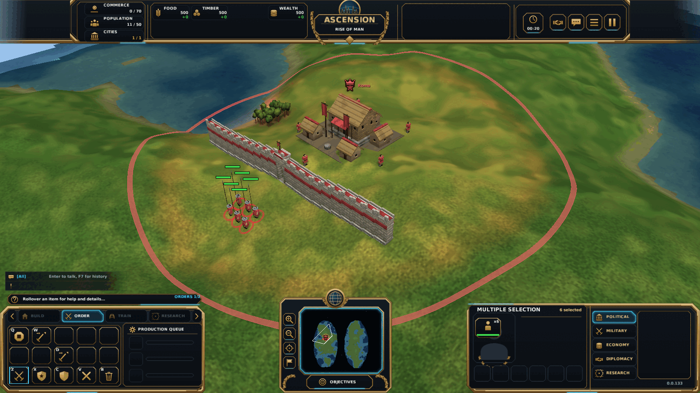</td>
<td>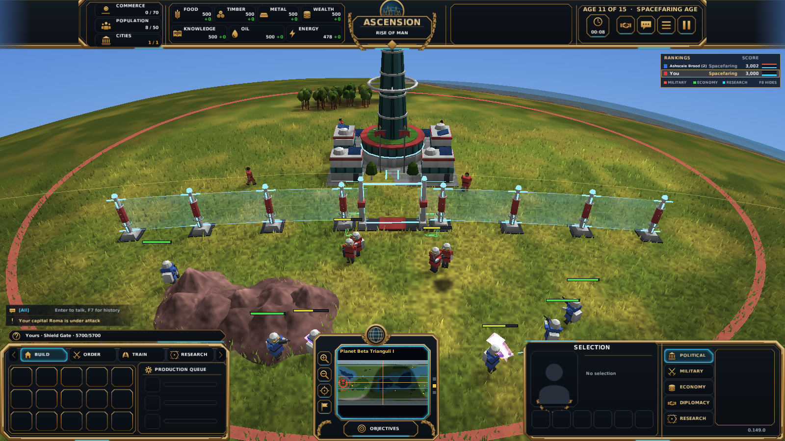</td>
</tr>
<tr>
<td align="center">A stone wall and its gate</td>
<td align="center">A shield line in the Spacefaring Age</td>
</tr>
</table>

### Over water, through the air, down from orbit

Cogs, fluyts, troopships and landing ships carry an army to another shore. Citizens and later
soldiers swim across shallow water. Jetpack infantry jump over walls and rivers, and from the
Starfaring Age troops drop from orbit in pods that come down like missiles. Production
buildings with lift-off engines fly away from a lost fight: across the planet, through the
star system and, in the last ages, to other stars.

<table>
<tr>
<td>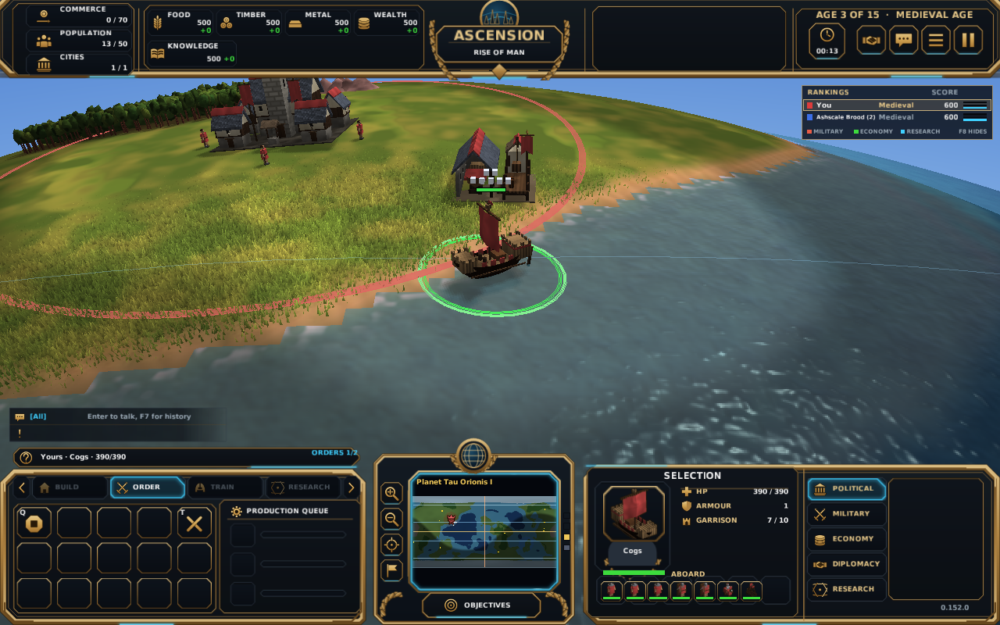</td>
<td>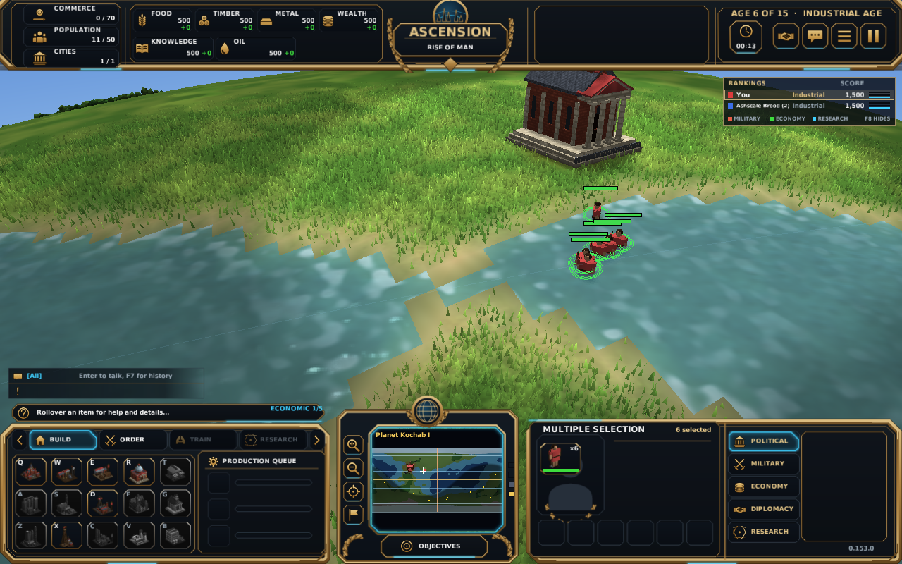</td>
</tr>
<tr>
<td align="center">A cog with soldiers aboard</td>
<td align="center">Swimming across a strait</td>
</tr>
<tr>
<td>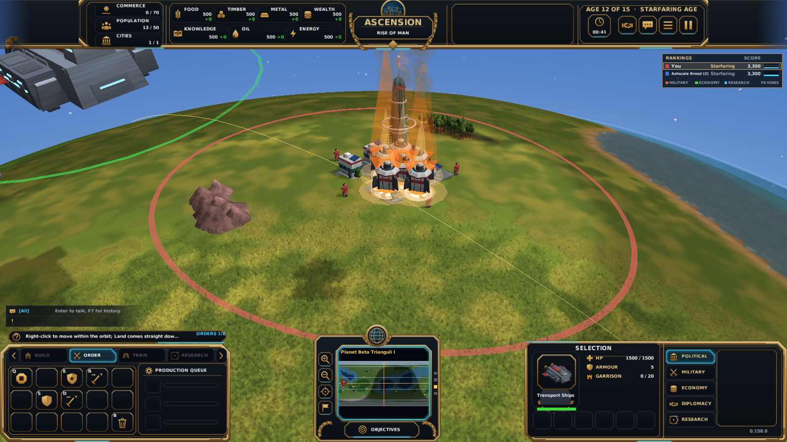</td>
<td>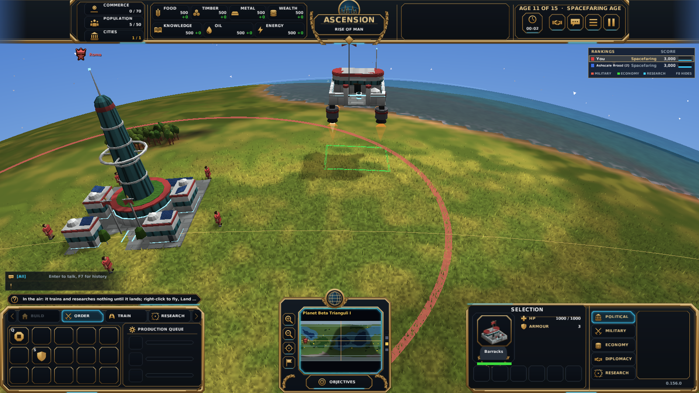</td>
</tr>
<tr>
<td align="center">An orbital drop</td>
<td align="center">A barracks lifting off</td>
</tr>
</table>

### Into space: star systems and the star map

From the Fusion Age your view opens beyond the home planet to the moons, asteroid belts and
gas giants of the home star, and your first ships settle its other worlds; from the Starfaring
Age ships jump to the other systems of their star cluster, and from the Age of Abundance to the
other clusters. Resource worlds are **claimed by keeping a
starship beside them**; habitable planets take colonies, and ground battles are fought on
their surfaces. Six map styles set the scale, from a single planet shared by everyone to a
solar system, a cluster, a sector, a quadrant or a whole galaxy, with 740 real stars grouped
into 160 clusters. The camera zooms out in steps: planet, star system, cluster, quadrant and
the galaxy, whose clusters lie on the galactic disk.

<table>
<tr>
<td>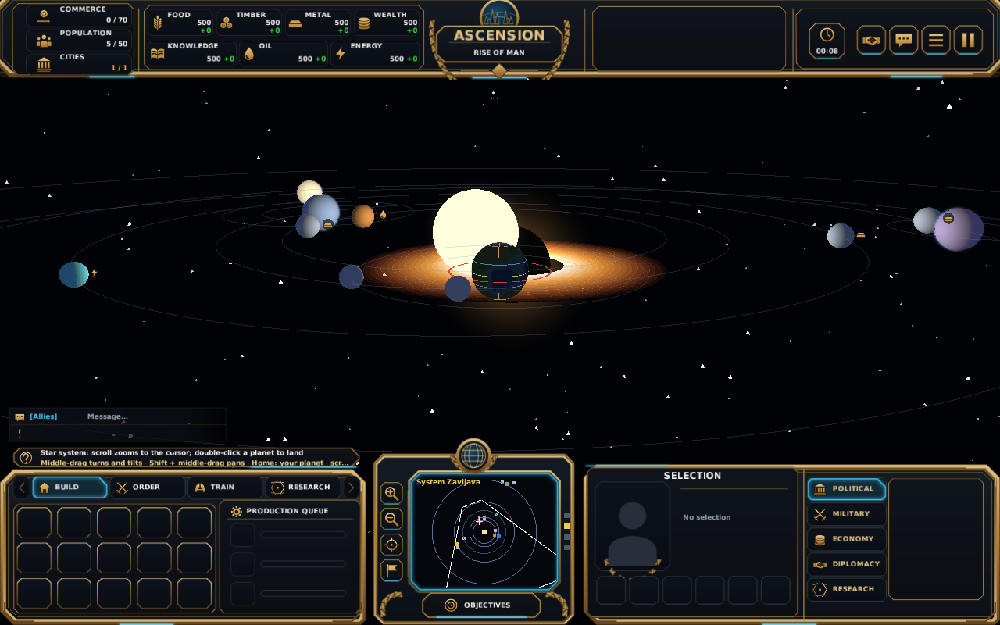</td>
<td>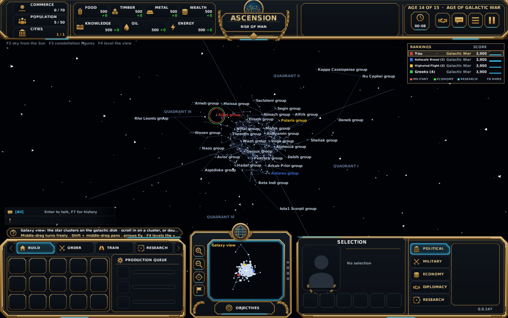</td>
</tr>
<tr>
<td align="center">A star system</td>
<td align="center">The galaxy view</td>
</tr>
</table>

### Routes, charged jumps and inhibitors

Ships travel between systems along **routes**. A fleet first charges its drive in place, then
jumps; a survey of the routes tells you where you can go and how long it takes. A **jump
inhibitor** built on a planet stops enemy fleets from arriving next to it: they come out at
the edge of the system and must cross it under fire.

<table>
<tr>
<td>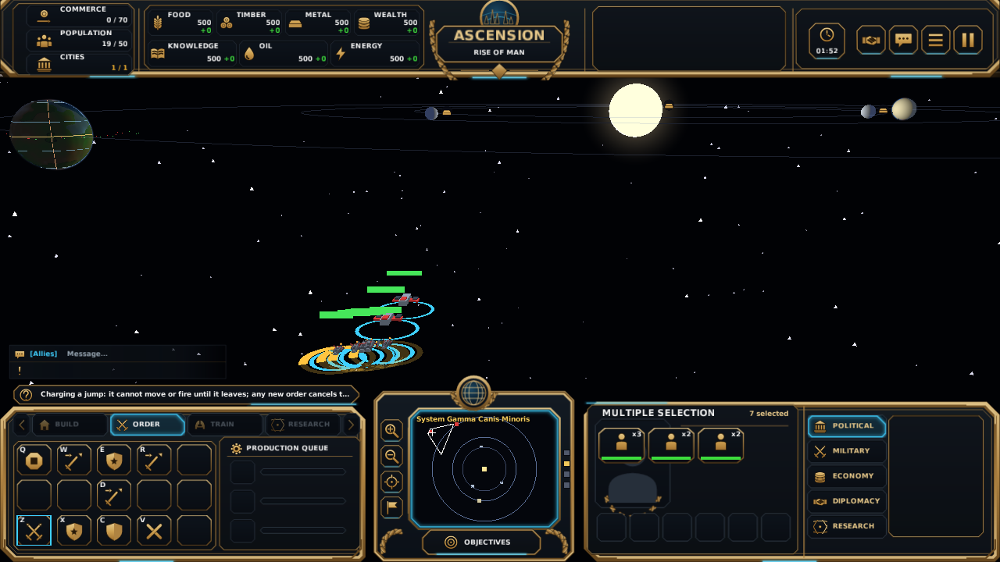</td>
<td>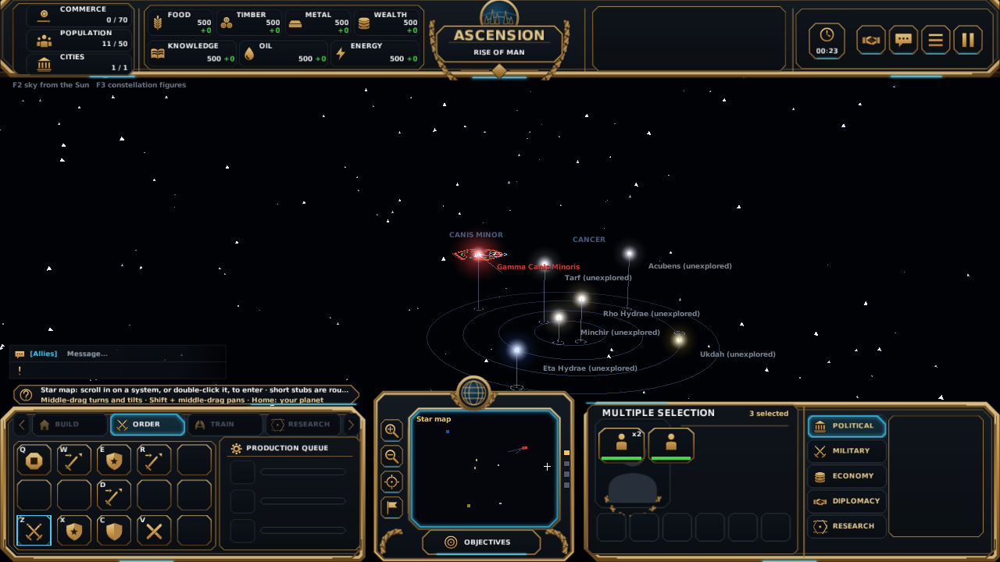</td>
</tr>
<tr>
<td align="center">A fleet charging its jump</td>
<td align="center">An inhibited system on the star map</td>
</tr>
<tr>
<td>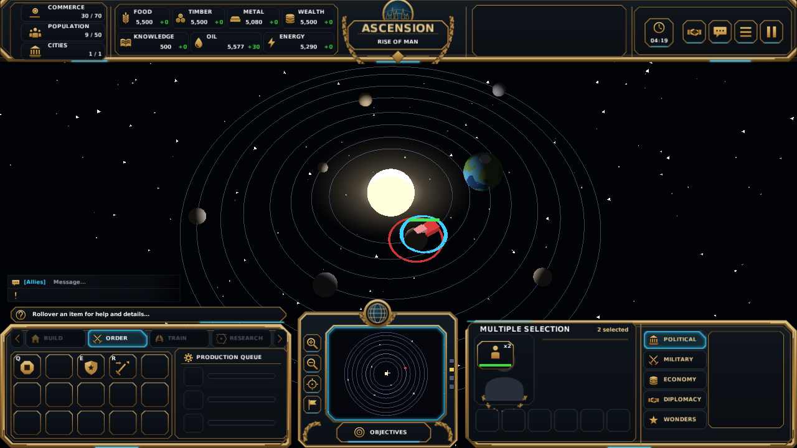</td>
<td>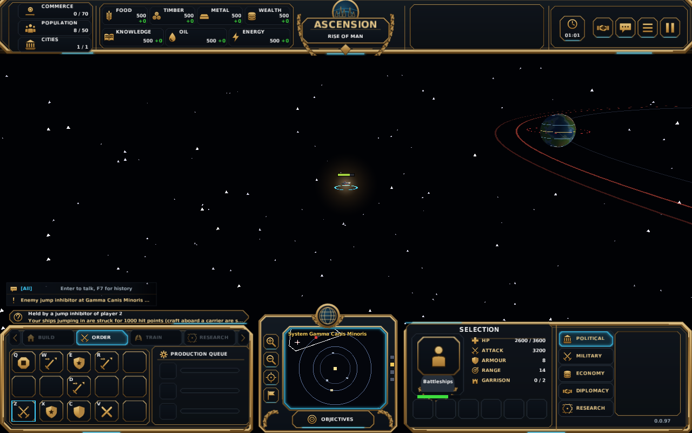</td>
</tr>
<tr>
<td align="center">Claiming a resource world</td>
<td align="center">Fleets in battle</td>
</tr>
</table>

### Computer opponents

Computer players use the same orders as people and nothing else. Four personalities
(Balanced, Boom and Build, Rush and Raid, Fortress) at six difficulties from Easiest to
Toughest. They scout other worlds, invade them by landing or orbital drop, carry armies over
the sea and swim across straits. A match can also be watched while computers play every seat.

### Ascension, and bringing worlds to life

Matches have no fixed end. A player who has researched everything at the library may begin
the **Ascension**: every rival is told, and has until it completes to defeat that player.
Ascended players leave their possessions behind, live at a celestial home beside the black
hole at the centre of the galaxy, travel freely, may descend again with a new city, and can
**bring life to barren moons and asteroids**: paint their land, oceans, forests, mountains and
deposits, at no cost.

<table>
<tr>
<td>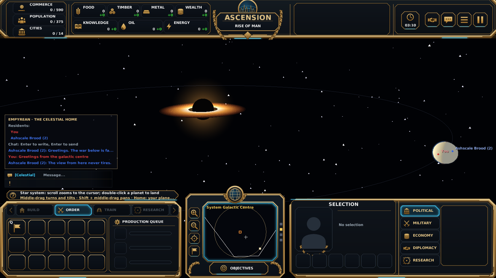</td>
<td>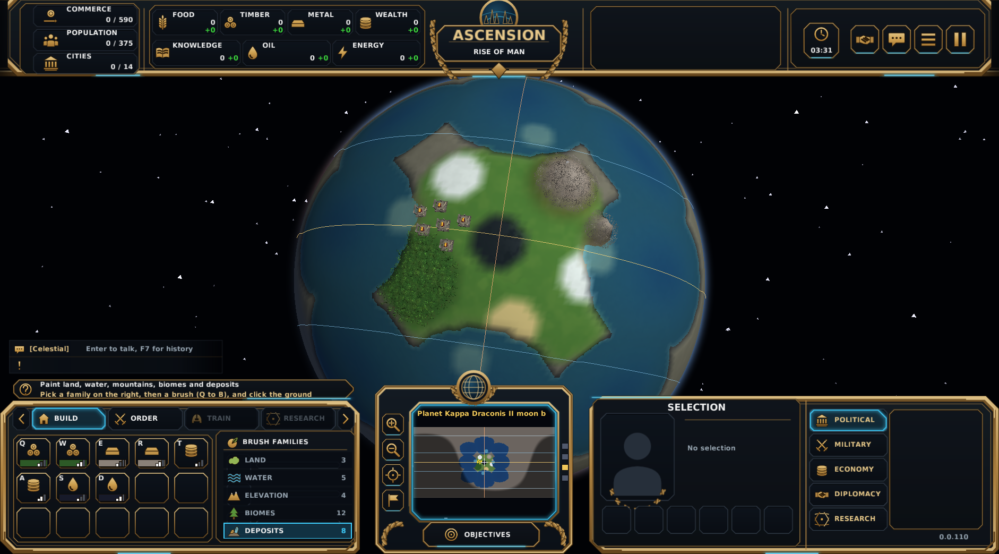</td>
</tr>
<tr>
<td align="center">The celestial home</td>
<td align="center">Painting a world</td>
</tr>
</table>

### Play together

Host a game from the launcher and send each friend a one-time key, join someone else's
game, or run a dedicated server (`rom serve`) on a small machine behind https. Every
machine runs the same deterministic simulation in lockstep; if a connection drops, a
computer player holds the seat until the person returns. Chat goes to everyone or to allies
only.

<table>
<tr>
<td>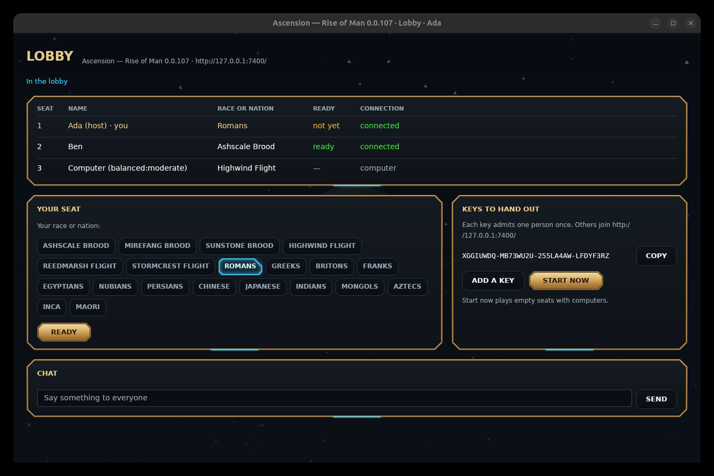</td>
<td>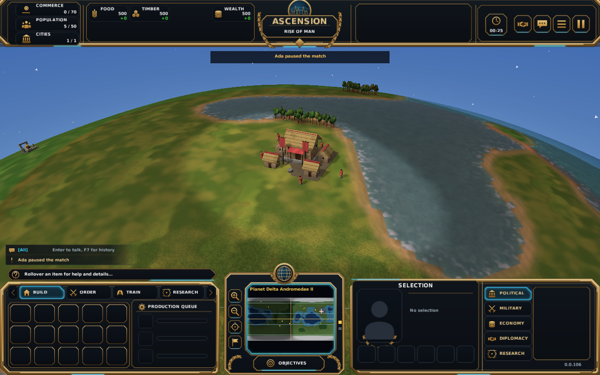</td>
</tr>
<tr>
<td align="center">The lobby</td>
<td align="center">A network match</td>
</tr>
</table>

### The launcher

Ready-made setups (a quick match, a classic cluster, a galactic war, a start in space, a
peaceful build, a sandbox with everything researched), saved games, a model gallery and the
advanced form with every option.

<p align="center">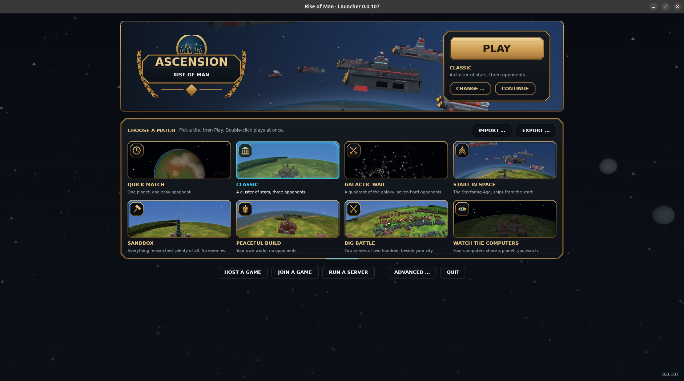</p>

## Install

Download from the [latest release](https://github.com/alfu32/ascension/releases/latest):

| System | File | Notes |
| --- | --- | --- |
| Linux x86_64 / aarch64 | `ascension-X.Y.Z-linux-<arch>.AppImage` | make it executable and run it; carries zsync update information |
| Linux x86_64 / aarch64 | `ascension_X.Y.Z_<arch>.snap` | `sudo snap install --dangerous ascension_*.snap`, then `ascension` (or `ascension.rom` for the command line) |
| Linux x86_64 / aarch64 | `ascension-X.Y.Z-<target>.tar.gz` | portable: unpack anywhere, run `rise-of-man` |
| Windows x64 / arm64 | `ascension-X.Y.Z-windows-<arch>.msi` | installs to Program Files with a Start-menu entry; uninstall from Settings |
| Windows x64 / arm64 | `ascension-X.Y.Z-windows-<arch>.msix` | the Microsoft Store package; to sideload it, first trust the `.cer` beside it |
| Windows x64 / arm64 | `ascension-X.Y.Z-<target>.zip` | portable: unpack anywhere, run `rise-of-man.exe` |
| macOS arm64 / x86_64 | `ascension-X.Y.Z-<target>.tar.gz` | portable, unsigned: unpack, then open `rise-of-man` (right-click → Open the first time) |

`SHA256SUMS.txt` lists the checksum of every file. Each package holds two programs:
`rise-of-man`, the game (no arguments opens the launcher), and `rom`, the command-line
runner and network server. Everything the game needs is built into them, so they run from
any folder.

## Technical part

Rust (1.99.1, edition 2024). raylib 6 renders the world and the in-match HUD offscreen; a
GPUI shell shows that image and draws every other screen (launcher, lobby, server window).
Meshes and materials are procedural: buildings and units are composed from a part kit and
baked into vertices before play, terrain and water are shader materials, and the sun is a
directional light with a shadow map.

- **Rules in SQLite.** Every age, unit, building, technology, modifier and map style is a row
  in the rules database (`app/db/schema.sql`, `app/db/seed.sql`, one model file per building
  or unit in `app/db/models/`). Code never branches on a definition's name; behaviour comes
  from components, tags, stats and modifiers. SQLite is the authoring and save format; the
  simulation never runs SQL.
- **Deterministic simulation.** Integers and fixed point only, one seeded random generator,
  iteration in id order, 20 ticks per game second (game speed changes ticks per real second).
  Players and computer players change the world only through orders. The same seed and
  orders give the same state hash on every machine, which is what network lockstep relies on.
- **Generated before play.** Maps, universes, deposits and baked meshes are made before the
  first tick; edits made by orders during a match (painting a world) are saved and re-bake
  only what they touch.

Crates (`app/crates/`):

| Crate | Purpose |
| --- | --- |
| `rom-rules` | load and validate the rules database into plain structs |
| `rom-sim` | deterministic simulation: state, tick, orders |
| `rom-geo` | pure geometry |
| `rom-mapgen` | maps and universes from a seed and a map style |
| `rom-ai` | computer players: read state, emit orders |
| `rom-save` | save and load a match |
| `rom-match` | one match for app and server: setup, computer players, leader and follower |
| `rom-net` | network play: protocol, server (lobby, keys, lockstep relay), client |
| `rom-kit` | the part kit: composed models baked into vertices |
| `rom-models` | model files, rules to kit parts, briefs |
| `rom-render` | raylib world and HUD drawing from render snapshots |
| `rom-app` | GPUI shell, screens, input, threads (binary `rise-of-man`) |
| `rom-cli` | headless runner, tools and the server (binary `rom`) |

### Building from source

Linux needs CMake, Clang and the X11, XKB, Wayland and OpenGL headers (on Debian or Ubuntu:
`cmake clang libclang-dev pkg-config libfontconfig1-dev libfreetype6-dev libx11-dev
libxcursor-dev libxrandr-dev libxinerama-dev libxi-dev libgl1-mesa-dev libxkbcommon-dev
libxkbcommon-x11-dev libwayland-dev libxcb1-dev`). Windows needs Visual Studio's C++ tools,
the Windows SDK and LLVM; macOS needs Xcode.

```sh
cd app
cargo build --release --locked -p rom-app -p rom-cli
target/release/rise-of-man            # the launcher (on Linux, X11 is the tested path)
target/release/rom --help             # the command-line runner and server

# the database by hand: schema, seed, then the model files (must print nothing)
sqlite3 /tmp/rom.db < db/schema.sql && sqlite3 /tmp/rom.db < db/seed.sql
cat db/models/materials.sql db/models/shared/*.sql \
    $(ls db/models/*.sql | grep -v '/materials.sql$') | sqlite3 /tmp/rom.db
sqlite3 /tmp/rom.db "PRAGMA foreign_key_check; SELECT * FROM lint_def_without_subtype; SELECT * FROM lint_unproducible;"

# the checks every change passes
cargo fmt --all --check
cargo clippy --workspace --all-targets --locked -- -D warnings
cargo test --workspace --locked
```

### Running a server

`rom serve` runs a match with no window (one match per process; it builds on a small
aarch64 machine without window libraries). Put it behind a web server that terminates
https, hand out keys with `rom keys add N`, and players join with
`https://<your domain>/<path>/` and a key. The launcher's **Run a server** form starts the
same server on a desktop. Details, options and a service file:
[`app/docs/network.md`](app/docs/network.md).

### Releases

`.github/workflows/release.yaml` builds every package at a version tag (the tag equals
`version` in `app/Cargo.toml`, with no `v` prefix) and publishes the release only when every
job passed. The release helpers are in `scripts/release/`, the package sources in
`packaging/`, and the Microsoft Store listing kit in `packaging/microsoft-store-kit/`.

### Design documents

| Path | Contents |
| --- | --- |
| `research/01-reference-data-model.md` | how the reference game models its rules, and what we change |
| `research/02-rendering-ui-stack.md` | raylib + GPUI integration, shadows, shader materials, baked vegetation, code editor |
| `research/03-timeline.md` | the 14 ages, reaching space, nations → blocs → humanity |
| `research/04-hud-and-screens.md` | in-match HUD, game setup, settings |
| `research/05-computer-opponents.md` | how computer players decide, difficulty levels, test harness |
| `app/db/schema.sql` | game database schema (rules + save state) |
| `app/db/seed.sql` | the rules data |
| `app/docs/database.md` | explanation of the schema and how to add content |
| `app/docs/implementation-plan.md` | crates, ground rules, phases and milestones |
| `app/docs/world-model.md` | round planets, star systems, continuous zoom |
| `app/docs/content.md` | technology tree, buildings and units: design and stat formulas |
| `app/docs/hud.md` | in-match HUD design: style, layout rectangles, how it is produced |
| `app/docs/network.md` | network play: lockstep, keys, the server |
| `app/docs/ascension.md`, `app/docs/bringing-life.md` | the Ascension and painting worlds |
| `app/docs/tasks/STATUS.md` | task ledger: what is running, merged or blocked |

## Licence

Copyright © 2026 alfu32. All rights reserved. The free version may be downloaded from the
official releases and played, hosted free of charge and shown in videos and streams. It may not
be redistributed, modified, reused or used commercially without the author's written agreement.
The full terms are in [LICENSE](LICENSE); the third-party components keep their own licences,
listed in [THIRD-PARTY-NOTICES.md](THIRD-PARTY-NOTICES.md).
